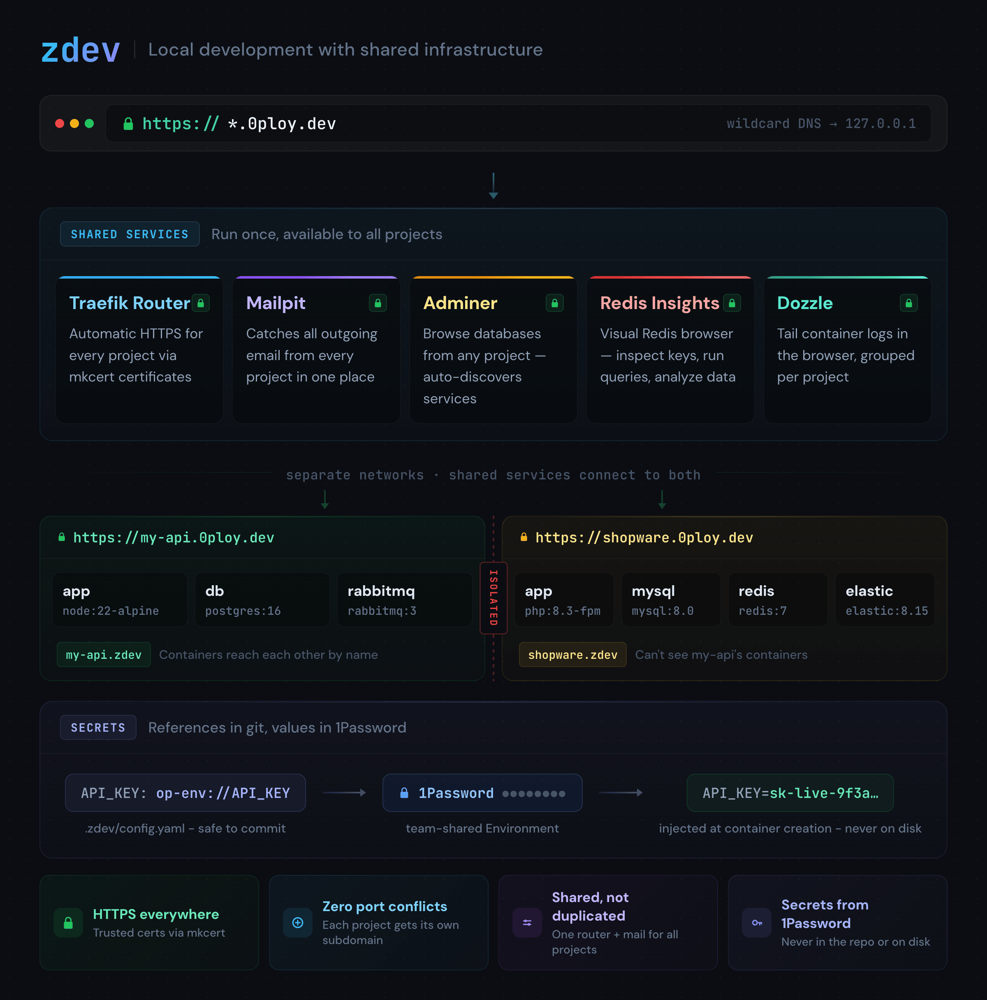

# zdev

**Ever seen a developer and an AI agent fall in love with a dev environment?** 🧑‍💻🤖❤️

zdev is a local development tool that gets you from `git clone` to coding in seconds: run `zdev start` and your whole project is up at `https://my-project.0ploy.dev` - HTTPS, routing, shared services, and secrets management included. Simple for AI coding agents to operate, powerful enough for complex multi-service setups - see [Agents](docs/agents.md).

> `0ploy.dev` is a wildcard DNS pointing to `127.0.0.1` - everything runs locally on your machine. No cloud, no accounts. You can use your own domain too.



## Quick Start

### 1. Install

Requires a Docker engine (Docker Desktop, OrbStack, Colima, or Docker Engine on Linux).

```bash
curl -fsSL https://raw.githubusercontent.com/0ploy/zdev/main/install.sh | sh
zdev systemcheck   # local SSL certificates + shared services
```

Engines, updates and the DNS fallback - see [Installation](docs/installation.md).

### 2A. Start an existing zdev project

```bash
git clone <repo> && cd <repo>
zdev start
```

Run project-specific commands (tests, migrations, consoles, ...) with `zdev run` - see [Project commands](docs/project-commands.md).

### 2B. Create a new project from a template

```bash
zdev create express my-app   # or nuxt4, symfony, any GitHub repo
cd my-app
zdev start
```

Browse all templates on [GitHub](https://github.com/orgs/0ploy/repositories?q=zdev-template-) or build your own - see [Templates](docs/templates.md#creating-a-template).

### 2C. Add zdev to your existing project with your coding agent

```bash
npx skills add 0ploy/zdev
```

Then ask your agent (Claude Code, Cursor, Copilot, ...) to *"set up zdev for this project"*. The skill teaches it the config format, the CLI, and the gotchas of common stacks. Prefer to write the config yourself - see [Configuration](docs/configuration.md).

> [!IMPORTANT]
> ### Security
>
> **Your code runs in containers, not on your machine.** Every `pnpm install`, `composer install` and dev server runs in an isolated container. A malicious package that tries to steal your SSH keys, read your browser cookies or encrypt your files stays trapped there - supply chain attacks on npm, PyPI and Packagist hit a throwaway container, not your host.
>
> **Your secrets live in 1Password, not in `.env` files.** The committed config holds only references; real values stay in your team's shared [1Password Environment](https://www.1password.dev/environments) and are injected when containers are created. Nothing to pass around on Slack, nothing to leak when the repo, a backup or an AI agent reads your config - see [Secrets](docs/secrets.md).

## Without zdev vs. with zdev

| Without zdev | With zdev |
|---------------|------------|
| Port conflicts between projects | Every project gets its own HTTPS subdomain |
| Each project configures its own mail, DB tools | Shared services run once, work for all projects |
| New developer spends a day setting up | Clone, `zdev start`, done |
| Complex Docker Compose with 100+ lines | One small config file with sensible defaults |
| Secrets passed around in `.env` files and Slack | Config references 1Password - commit it, clone it, `zdev start` |
| Slow file sync on macOS | Native-speed file sync, zero config |
| Agents guess ports, container names and setup steps | One command, predictable URLs, `zdev exec` and `zdev run` |
| Malicious packages can access your entire machine | Code runs in isolated containers - supply chain attacks stay sandboxed |

## How It Works

Every project runs in its own isolated Docker network and gets its own HTTPS subdomain through a shared [Traefik](https://traefik.io/) router.

- **One config file.** `.zdev/config.yaml` describes the services; zdev creates the network, containers, routing and certificates. [Configuration](docs/configuration.md) · [Examples](docs/examples.md)
- **HTTPS everywhere.** Every project and service gets a locally-trusted certificate and its own subdomain. [HTTPS and DNS](docs/https-and-dns.md) · [Routing](docs/routing.md)
- **Shared services.** Mailpit, Adminer, Redis Insights and Dozzle run once for all projects. [Shared services](docs/shared-services.md)
- **Fast file sync on macOS.** Source code syncs at native speed while `node_modules` stays inside the container. [File sync](docs/file-sync.md)
- **Project commands.** `.zdev/run/*.toml` files hold the project's tasks, run with `zdev run`. [Project commands](docs/project-commands.md)
- **Projects call each other by their real URLs**, from inside containers too, with trusted HTTPS. [Routing](docs/routing.md#calling-other-projects-from-a-container)
- **Direct container access across projects** through named link networks. [Linking](docs/linking.md)

## Documentation

[Installation](docs/installation.md) · [Agents](docs/agents.md) · [CLI reference](docs/cli.md) · [Configuration](docs/configuration.md) · [Examples](docs/examples.md) · [Project commands](docs/project-commands.md) · [Templates](docs/templates.md) · [Shared services](docs/shared-services.md) · [HTTPS and DNS](docs/https-and-dns.md) · [Routing](docs/routing.md) · [File sync](docs/file-sync.md) · [Secrets](docs/secrets.md) · [Linking](docs/linking.md) · [Troubleshooting](docs/troubleshooting.md)

---

[Contributing](CONTRIBUTING.md) · Built on [great open-source tools](docs/credits.md) · MIT License
